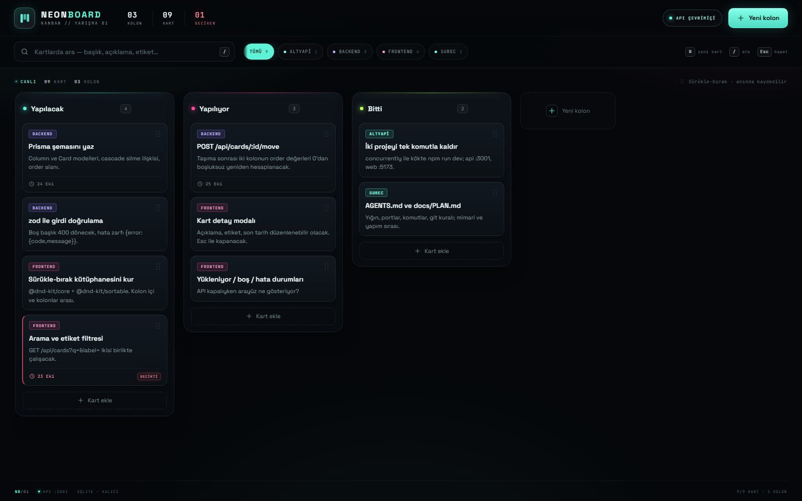

# NeonBoard — Neon Kanban

API sözleşmesine birebir uyan, sürükle-bırak çalışan, SQLite'ta kalıcı ve neon ışıltılı
bir Kanban panosu. `api/` ve `web/` ayrı projelerdir; kökten tek komutla birlikte kalkar.




## Kurulum ve çalıştırma

Gereksinim: **Node.js 24+** (yerleşik `node:sqlite` kullanılır) ve npm.

```bash
npm install     # kökte: api + web bağımlılıkları (npm workspaces)
npm run dev     # api :3001 + web :5173 birlikte
```

Aç: **http://localhost:5173**

İlk açılışta `api/data/kanban.db` otomatik oluşturulur ve `data/board.json`
(3 kolon / 9 kart) yüklenir. Sunucuyu kapatıp açsan da veri yerinde kalır.

### Tek tek çalıştırma

```bash
npm run dev:api   # sadece API  → http://localhost:3001
npm run dev:web   # sadece web  → http://localhost:5173
```

Kurulumu ayrı ayrı yapmak istersen:

```bash
cd api && npm install && npm run dev
cd web && npm install && npm run dev
```

### Diğer komutlar

```bash
npm run test:api   # API çekirdeği duman testleri (geçici DB, panoya dokunmaz)
npm run seed       # panoyu data/board.json demo verisine sıfırla
npm run build      # tip kontrolü + web üretim derlemesi
```

### Temiz kurulum provası

```bash
rm -rf node_modules api/node_modules web/node_modules api/data/kanban.db*
npm install
npm run dev
```

PowerShell:

```powershell
Remove-Item -Recurse -Force node_modules,api/node_modules,web/node_modules -ErrorAction SilentlyContinue
Remove-Item -Force api/data/kanban.db* -ErrorAction SilentlyContinue
npm install
npm run dev
```

## Özellikler

- **Sürükle-bırak** — kolon içi sıralama ve kolonlar arası taşıma (`@dnd-kit`).
  Bırakılacak kolon neon çerçeveyle parlar; sıra anında API'ye yazılır.
- **Kolon & kart CRUD** — başlık düzenleme, kart oluşturma, detay modalı, silme onayı.
- **İyimser güncelleme** — işlem anında ekrana yansır; API hata verirse eski hâle
  döner ve sağ altta uyarı çıkar (TanStack Query `onMutate` / `onError`).
- **Arama + etiket filtresi** — ikisi birlikte (AND); Türkçe duyarsız:
  `İstanbul` ↔ `istanbul`, `IŞIK` ↔ `isik`.
- **Kart detayı** — açıklama, etiket, son tarih; `Ctrl/Cmd + Enter` ile kaydet.
- **Geciken kartlar** — geçmiş tarih kırmızı kenar, `GECİKTİ` rozeti ve kırmızı saat.
- **Üç durum** — yükleniyor iskeleti, boş pano/kolon, API kapalıyken hata paneli + tekrar dene.
- **Klavye** — `N` yeni kart, `/` aramaya odak, `Esc` modal/composer kapat.
- **Responsive** — 1024px altında kolonlar yatay kaydırmalı; 720px altında modal alt sayfa.
- **Uzun metin** — 500 karakterlik başlık/açıklama taşmaz; kartta 3/2 satır clamp,
  tamamı modalda görünür.
- **Kalıcılık** — SQLite (WAL), `PRAGMA foreign_keys` ile cascade silme.

## Klavye kısayolları

| Tuş | İşlev |
| --- | --- |
| `N` | İlk kolonda yeni kart yazma alanını açar |
| `/` | Arama alanına odaklanır |
| `Esc` | Modal / kart yazma / yeni kolon alanını kapatır |
| `Ctrl` + `Enter` | Kart detayını kaydeder |

## Mimari

```
.
├── api/                 Express 4 + TS + zod + node:sqlite  (:3001)
│   └── src/
│       ├── index.ts     rotalar, doğrulama, hata zarfı
│       ├── db.ts        şema, sorgular, move, import/export, arama
│       ├── seed.ts      demo verisine sıfırlama
│       └── smoke.ts     duman testleri
├── web/                 Vite + React 18 + TS + @dnd-kit  (:5173)
│   └── src/
│       ├── App.tsx      sorgu, filtre, klavye, modal
│       ├── api.ts       tipli fetch istemcisi
│       ├── utils.ts     TR-duyarsız arama, tarih, move
│       ├── styles.css   neon tasarım sistemi
│       ├── hooks/       iyimser mutation'lar
│       └── components/  Header, Board, Column, CardItem, CardModal
├── data/board.json      başlangıç panosu
└── docs/                PLAN.md · API.md · KABUL.md
```

Arayüz veriyi **yalnızca** API'den alır (Vite `/api` proxy → `:3001`). Frontend'de
sabit pano dizisi yoktur. Detaylı sözleşme: [`docs/API.md`](docs/API.md).

## API özeti

| Metot | Yol | Yanıt |
| --- | --- | --- |
| GET | `/api/health` | 200 · `{status:"ok"}` |
| GET | `/api/board` | 200 · pano |
| POST | `/api/columns` | 201 · kolon |
| PATCH | `/api/columns/:id` | 200 · kolon |
| DELETE | `/api/columns/:id` | 204 · cascade |
| POST | `/api/cards` | 201 · kart |
| PATCH | `/api/cards/:id` | 200 · kart |
| DELETE | `/api/cards/:id` | 204 |
| POST | `/api/cards/:id/move` | 200 · sıralar 0..n-1 |
| GET | `/api/cards?q=&label=` | 200 · `{cards:[…]}` |
| POST | `/api/import` | 200 · temizle + yükle |
| GET | `/api/export` | 200 · `{board:{…}}` |

Her hata `{ "error": { "code": "…", "message": "…" } }` zarfıyla döner.

## Doğrulama

`npm run test:api` → **11 kontrol**: seed, kolon/kart CRUD, cascade, move sonrası
0..n-1 sıra, Türkçe duyarsız arama + etiket AND, import/export round-trip, 6 kolon /
120 kart.

Tarayıcıda ayrıca doğrulandı:

- **13 arayüz akışı** — modal düzenleme, `N` / `/` / `Esc`, kolon içi ve kolonlar arası
  sürükleme, yenileme sonrası kalıcılık, kart silme, 390px mobilde yatay taşma yok.
- **Gizli pano provası** — 6 kolon / 120 kart import; 200 karakterlik başlıklar taşmıyor,
  60 geciken kart işaretli, `İSTANBUL` araması 30 sonuç, sürükleme akıcı, reload tutarlı.
- **İyimser rollback** — `move` isteği bilerek düşürüldü: kart kaynak kolona döndü,
  hata toast'ı göründü.
- **Durumlar** — yükleniyor iskeleti, API kapalı hata paneli, boş pano CTA'sı.
- **Kalıcılık** — SQLite dosyası kapatılıp yeniden açıldı; kolon ve kart yerinde.
- **Kolon CRUD** — arayüzden kolon ekleme, adını düzenleme ve onaylı silme API'ye işledi.

## Tasarım notları

- Koyu `#05070a` zemin, neon mint `#5ef2d6` ana vurgu, magma `#ff4d9d` ikincil.
- Space Grotesk (başlık) + JetBrains Mono (metrik/etiket) — yerel yedekli.
- 8px ızgara, 16-18px panel yarıçapı, 1px çizgiler, katmanlı gölge.
- Kolon başına neon aksan çizgisi; sürüklemede hedef kolon parlar ve `BURAYA` çipi çıkar.

## Lisans

Yarışma teslimi — MIT benzeri serbest kullanım.
